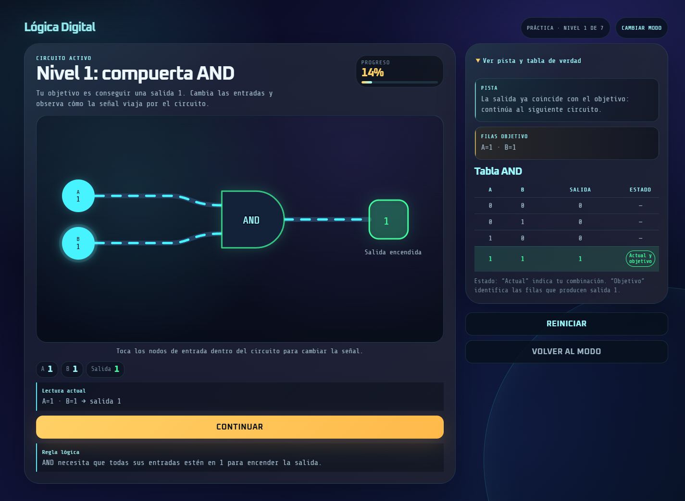
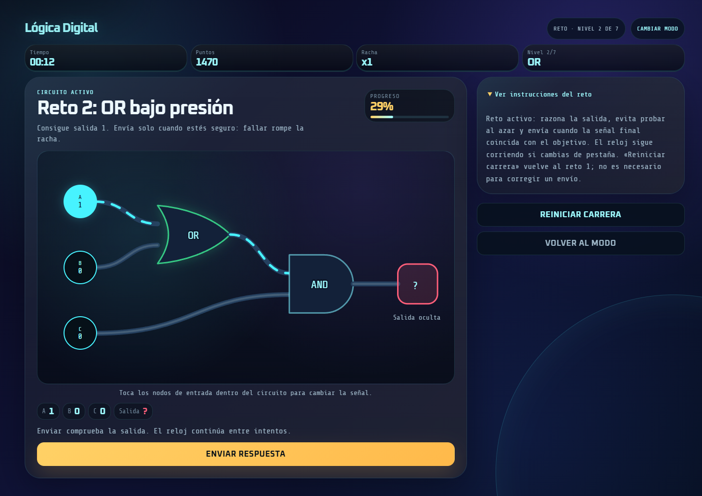

# Lógica Digital — Digital Logic Lab

<div align="center">

**Aprende compuertas lógicas experimentando con circuitos interactivos.**

[](https://github.com/Sam-24-dev/Logis-Gates-Challenge-Game/actions/workflows/ci.yml)
[](https://github.com/Sam-24-dev/Logis-Gates-Challenge-Game/releases/tag/logic-gates-challenge-game-v2.3.1)


[](https://github.com/Sam-24-dev/Logis-Gates-Challenge-Game/blob/main/LICENSE)

**[Abrir demo](https://logis-gates-challenge-game.vercel.app/) · [Ver release](https://github.com/Sam-24-dev/Logis-Gates-Challenge-Game/releases/tag/logic-gates-challenge-game-v2.3.1) · [Explorar código](https://github.com/Sam-24-dev/Logis-Gates-Challenge-Game)**

</div>

## Del concepto al circuito

Las compuertas lógicas pueden resultar abstractas cuando solo se estudian sus símbolos y tablas. **Digital Logic Lab** permite cambiar entradas binarias, observar su efecto y relacionar la salida del circuito con una regla lógica.

Es una aplicación educativa de frontend, dirigida a personas que empiezan con lógica digital o quieren repasar sus fundamentos. Combina **siete lecciones de práctica** y **siete retos de circuitos** con identidad visual de laboratorio digital.

**Versión 2.3.1 publicada el 11 de octubre de 2026.** Demo disponible en Vercel. Se puede jugar sin registro ni instalar la aplicación. Es un recurso de práctica; no sustituye un curso ni acredita aprendizaje por sí solo.

## Así se ve

### Práctica: experimentar y entender



### Reto: razonar antes de enviar



Capturas reales de la demo pública, tomadas el **12 de octubre de 2026 (UTC)** en Chrome, viewport 1440 × 1000. No son prototipos. El tiempo y los puntos pertenecen a una sesión de demostración automatizada; no son métricas de aprendizaje o rendimiento.

## Qué puedes hacer

| Experiencia | Funcionalidad |
| --- | --- |
| **Práctica guiada** | Explorar AND, OR, NOT, XOR, NAND, NOR y XNOR sin reloj, con pistas, reglas y tablas de verdad. |
| **Circuitos interactivos** | Alternar entradas desde los nodos, seguir las señales y observar el estado de la salida. |
| **Modo reto** | Resolver siete circuitos combinados. La salida se revela al enviar; el tiempo, los errores y la racha intervienen en la puntuación. |
| **Resultados** | Ver el recorrido completado y, en reto, distinguir puntuación, mejor racha de la partida y récords locales. |
| **Progreso local** | Conservar avance y récords en el navegador mediante `localStorage`, con manejo de datos inválidos y fallos de guardado. |

### Cómo se juega

1. **Elige una ruta:** práctica para aprender o reto para resolver circuitos con tiempo y puntuación.
2. **Cambia las entradas:** cada nodo alterna entre `0` y `1`.
3. **Observa o comprueba:** en práctica la salida y la explicación se actualizan; en reto debes enviar la respuesta.
4. **Avanza:** completa la ruta y consulta el resumen. Puedes volver a practicar o iniciar otra carrera.

## Ingeniería detrás de la experiencia

| Área | Implementación |
| --- | --- |
| Interfaz | React 19 + TypeScript con comprobación estricta de tipos. |
| Desarrollo y build | Vite; generación de archivos estáticos para despliegue. |
| Circuitos | SVG y controles HTML asociados; geometría derivada de la topología del circuito. |
| Estilos y señales | CSS propio, tokens visuales y animaciones CSS/Web Animations. |
| Reglas | Funciones de evaluación, tablas de verdad, feedback, puntuación y progreso independientes de las pantallas. |
| Pruebas | Vitest + Testing Library para lógica y comportamiento de interfaz. |
| CI/CD | GitHub Actions para calidad; Release Please para versiones; despliegues en Vercel. |

```text
src/
├── app/          # Flujo de pantallas, estado de partida y persistencia
├── components/   # Interfaz reutilizable y CircuitBoard
├── core/         # Reglas del juego y funciones comprobables por separado
├── data/         # Catálogo declarativo de compuertas y niveles
├── screens/      # Bienvenida, selección de modo, niveles y resultados
├── styles/       # Tokens, layout, controles y movimiento
└── test/         # Preparación y utilidades de pruebas
```

### Decisiones de diseño

- **Lógica separada de React:** facilita comprobar las reglas y evolucionar el contenido sin mezclar cálculo y presentación.
- **SVG en lugar de un motor 3D:** permite expresar la topología y coordinar cables, símbolos y controles sin añadir complejidad innecesaria.
- **Un mismo circuito como fuente de verdad:** la evaluación y el feedback educativo se basan en la definición del circuito, evitando explicaciones divergentes.
- **Carga por pantallas:** niveles y resultados se cargan en chunks separados; hay recuperación ante fallos de carga.
- **Guardado local y explícito:** se manejan datos corruptos o almacenamiento no disponible, sin presentar un guardado fallido como persistido.
- **Movimiento con propósito:** acompaña señales y cambios de estado; se contempla la preferencia de movimiento reducido.

## Calidad y alcance de la validación

El [workflow de CI](https://github.com/Sam-24-dev/Logis-Gates-Challenge-Game/actions/workflows/ci.yml) ejecuta lint, tests, build y audit de dependencias en pull requests y en `main`.

**Snapshot de la release 2.3.1, 11 de octubre de 2026:** el [CI de su commit publicado](https://github.com/Sam-24-dev/Logis-Gates-Challenge-Game/actions/runs/38154439987) aprobó **228 tests en 26 archivos**, lint y build; audit reportó **0 vulnerabilidades** en esa ejecución. Es un resultado fechado, no una garantía permanente ni una auditoría de seguridad completa.

La interfaz incorpora estructura semántica, nombres de controles, enlaces para saltar al contenido, gestión de foco y estados que no dependen únicamente del color. Las pruebas automáticas y las muestras de navegador comprueban comportamientos concretos, **no certifican conformidad WCAG**. Sigue pendiente ampliar la comprobación con lector de pantalla, zoom real al 200%/400% y contraste de todos los estados.

El [informe histórico de Fase 10](https://github.com/Sam-24-dev/Logis-Gates-Challenge-Game/blob/main/documentation/phase10-final-qa-report.md) corresponde a un preview local de aquel build; sus métricas Lighthouse no describen necesariamente la demo actual ni todos los dispositivos.

## Ejecutarlo localmente

Necesitas Git, Node.js y npm. CI utiliza **Node.js 22.20.0** como entorno de referencia; no se presenta como una versión mínima formalmente declarada.

```sh
git clone https://github.com/Sam-24-dev/Logis-Gates-Challenge-Game.git
cd Logis-Gates-Challenge-Game
npm ci
npm run dev
```

Abre la URL que muestre Vite, normalmente `http://localhost:5173/`. Estos comandos usan la rama predeterminada; para consultar exactamente la versión documentada, utiliza el tag `logic-gates-challenge-game-v2.3.1`.

Para comprobar y previsualizar un build:

```sh
npm run test
npm run lint
npm run build
npm audit --audit-level=high
npm run preview
```

El preview sirve el build local; no publica una release ni modifica la demo de Vercel.

## Despliegue y límites actuales

La demo oficial es una SPA estática en **Vercel**. Su configuración incluye fallback de navegación, caché de assets y cabeceras como CSP. Las fuentes se sirven localmente. [Configuración de despliegue](https://github.com/Sam-24-dev/Logis-Gates-Challenge-Game/blob/main/vercel.json).

- No hay backend, IA, cuentas, almacenamiento en la nube, ranking online ni multijugador.
- El progreso pertenece a ese navegador y origen: puede perderse al borrar sus datos y no se sincroniza entre dispositivos.
- Los récords son personales y locales, no resultados verificados para competición pública.
- El catálogo y el dibujo tienen límites deliberados. Más niveles son viables, pero requieren ajustar conteos, persistencia y pruebas; no es un editor libre de circuitos.
- No se promete disponibilidad continua, capacidad de tráfico concreta ni funcionamiento idéntico en todos los dispositivos.

Las [mejoras futuras](https://github.com/Sam-24-dev/Logis-Gates-Challenge-Game/blob/main/documentation/future-improvements.md) son propuestas opcionales, no características implementadas ni requisitos para usar esta versión.

## Versiones y documentación

- [Release 2.3.1](https://github.com/Sam-24-dev/Logis-Gates-Challenge-Game/releases/tag/logic-gates-challenge-game-v2.3.1): correcciones de racha de partida, guardado final y foco después de una respuesta incorrecta.
- [Changelog](https://github.com/Sam-24-dev/Logis-Gates-Challenge-Game/blob/main/CHANGELOG.md): evolución entre versiones.
- [Proceso de releases](https://github.com/Sam-24-dev/Logis-Gates-Challenge-Game/blob/main/documentation/release-process.md): automatización y verificación de publicación.
- [Plan V2 — histórico, fases completadas](https://github.com/Sam-24-dev/Logis-Gates-Challenge-Game/blob/main/documentation/v2-product-implementation-plan.md): decisiones y recorrido de implementación, no estado pendiente de esta versión.
- [Análisis V1 — histórico](https://github.com/Sam-24-dev/Logis-Gates-Challenge-Game/blob/main/documentation/repository-analysis.md): contexto previo a la migración, no descripción del stack actual.

Para comunicar un problema o sugerir una mejora, utiliza las [issues del repositorio](https://github.com/Sam-24-dev/Logis-Gates-Challenge-Game/issues).

## Licencias

El código original se distribuye bajo [MIT](https://github.com/Sam-24-dev/Logis-Gates-Challenge-Game/blob/main/LICENSE).

Las fuentes **Oxanium** y **Share Tech Mono** se distribuyen por separado bajo sus licencias **SIL Open Font License**; no quedan relicenciadas como MIT. Sus avisos están en [OFL-Oxanium.txt](https://github.com/Sam-24-dev/Logis-Gates-Challenge-Game/blob/main/public/fonts/OFL-Oxanium.txt) y [OFL-Share-Tech-Mono.txt](https://github.com/Sam-24-dev/Logis-Gates-Challenge-Game/blob/main/public/fonts/OFL-Share-Tech-Mono.txt), conservados desde [google/fonts@23e54b5](https://github.com/google/fonts/tree/23e54b51ddffbc7713c583748e3bd86f62b1fa4a).

---

<div align="center">

### Autor

**Samir Caizapasto**<br />
*Desarrollador de software y creador de Digital Logic Lab*

Proyecto de **Software/Frontend Engineering**, dentro de mi trayectoria en Software Engineering, Data Engineering/Data Science y Applied AI/ML.

**[Portafolio](https://portafolio-samir-tau.vercel.app/) · [LinkedIn](https://www.linkedin.com/in/samir-caizapasto/) · [Correo](mailto:samir.leonardo.caizapasto04@gmail.com)**

Si el laboratorio te resulta útil para aprender o repasar lógica digital, puedes apoyar el proyecto con una estrella.

</div>
